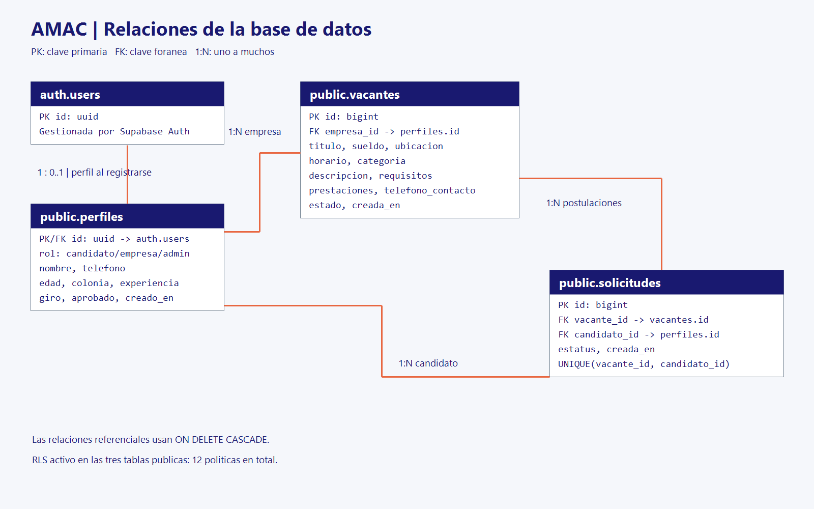

# Plataforma de empleo AMAC — Entrega 3 (React, Supabase y Vercel)

Proyecto final **OT2026-WEB**. AMAC es una plataforma de empleo para **personas adultas mayores** en Monterrey y su área metropolitana. En esta entrega, el sitio HTML/CSS de la Entrega 2 se convirtió en una **aplicación web real**: el frontend está hecho en React (Vite), los datos viven en PostgreSQL dentro de Supabase (con inicio de sesión y seguridad por fila) y la aplicación se publica en Vercel.

- **Repositorio:** https://github.com/potamo117/amac-react
- **Aplicación publicada (Vercel):** _pendiente: pegar la URL_
- **Video de la presentación:** _pendiente: pegar el enlace_
- **Diapositivas:** _pendiente: pegar el enlace o subir el PDF a `docs/`_
- **Entrega 2 (HTML y CSS):** https://amac-web-gamma.vercel.app

---

## Integrantes y qué hizo cada uno

| Integrante | Rol | Trabajo |
|---|---|---|
| **Luis Carlos Ramírez Mora** | Persona 1 — Base de React, vacantes públicas y despliegue | Proyecto Vite, estructura `src/`, estilos migrados de la Entrega 2 y componentes compartidos. Rutas, `AuthContext` y `RutaProtegida`. Listado con búsqueda y filtros, detalle de vacante con «Llamar» y «Mis solicitudes» con cancelación. Despliegue en Vercel (`vercel.json`, variables de entorno) y revisión de Pull Requests. _(ajustar al terminar)_ |
| **Victor Gilberto Márquez Gallegos** | Persona 2 — Base de datos, seguridad y acceso | Proyecto de Supabase, `supabase/esquema.sql`, restricciones y políticas RLS. Registro de candidato, inicio y cierre de sesión, postulación (una sola vez y solo candidatos aprobados) y cuentas de prueba. _(ajustar al terminar)_ |
| **Adriana Montserrat Reyna Cuatianquiz** | Persona 3 — Empresa, calidad y documentación | Registro de empresa, publicar vacante, mis vacantes (pausar, reactivar, cerrar) y solicitudes recibidas con cambio de estatus. Pruebas de la sección 5.12, accesibilidad, este README y coordinación del video. _(ajustar al terminar)_ |

---

## Tecnologías

| Capa | Tecnología | Para qué se usa |
|---|---|---|
| Frontend | React con Vite y React Router | Componentes, estado (`useState`), efectos (`useEffect`), rutas y ruta protegida por rol |
| Sesión | Context de React y Supabase Auth | Saber quién está conectado y con qué rol |
| Base de datos | PostgreSQL en Supabase | Tablas `perfiles`, `vacantes` y `solicitudes` |
| Seguridad | Row Level Security (RLS) | Cada usuario solo ve y cambia lo que le corresponde |
| Publicación | Vercel conectado a GitHub | Cada `git push` a `main` publica una versión nueva con HTTPS |

### Cómo correr el proyecto en su computadora

Requiere **Node.js 20 o superior** (`node -v`).

```bash
git clone <URL-del-repositorio>
cd amac-react
npm install
```

Cree el archivo `.env.local` en la raíz del proyecto (a partir de `.env.example`) con los datos de Supabase (Project Settings → API Keys):

```
VITE_SUPABASE_URL=https://xxxxxxxx.supabase.co
VITE_SUPABASE_PUBLISHABLE_KEY=sb_publishable_xxxxxxxx
```

```bash
npm run dev
```

Abra http://localhost:5173. Después de crear o editar `.env.local`, detenga y vuelva a correr `npm run dev`.

> `.env.local` no se sube a GitHub. La llave `service_role` o *secret key* nunca se usa en el código.

---

## Cuentas de prueba

| Rol | Correo | Contraseña | Nota |
|---|---|---|---|
| Candidato **aprobado** | _pendiente_ | _pendiente_ | Puede postularse |
| Candidato **sin aprobar** | _pendiente_ | _pendiente_ | La postulación debe quedar bloqueada |
| Empresa | _pendiente_ | _pendiente_ | Publica vacantes y revisa solicitudes |

La aprobación de candidatos (RF-054) se hace desde el Table Editor de Supabase, cambiando `aprobado` a `true` en la tabla `perfiles`.

---

## Base de datos

El SQL completo está en [`supabase/esquema.sql`](supabase/esquema.sql).



Para la demo, [`supabase/datos-ejemplo.sql`](supabase/datos-ejemplo.sql) carga 8 vacantes de ejemplo a nombre de la primera empresa registrada.

| Tabla | Qué guarda | Restricciones principales |
|---|---|---|
| `perfiles` | Un perfil por usuario de Supabase Auth: rol (`candidato`, `empresa` o `admin`), nombre, teléfono, edad, colonia, experiencia, giro y si está aprobado | `id` es llave foránea de `auth.users`; `rol` y `edad` con `check`; un *trigger* crea el perfil al registrarse |
| `vacantes` | Empleos publicados por una empresa | `empresa_id` apunta a `perfiles`; `sueldo > 0`; `horario` y `estado` (`activa`, `pausada`, `cerrada`) con `check`; `telefono_contacto` nulo significa que solo se postula por la plataforma |
| `solicitudes` | Postulaciones de un candidato a una vacante | `unique (vacante_id, candidato_id)` impide postularse dos veces (RF-004); `estatus` con `check` |

### Políticas RLS (12 en total, 4 por tabla)

| Tabla | Política | Qué protege |
|---|---|---|
| `perfiles` | Cada quien ve su perfil | Un usuario solo lee su propia fila |
| `perfiles` | Todos ven los perfiles de empresas | El candidato puede mostrar el nombre de la empresa en cada vacante |
| `perfiles` | La empresa ve a quien aplicó a sus vacantes | Una empresa solo ve a los candidatos que se postularon con ella |
| `perfiles` | Cada quien edita su perfil | Solo se edita el propio; además, `revoke`/`grant` impiden cambiar `rol` y `aprobado` |
| `vacantes` | Ver vacantes activas o las propias | El público solo ve `activa`; la empresa ve también sus pausadas y cerradas |
| `vacantes` | El candidato sigue viendo las vacantes a las que aplicó | Aunque la empresa la pause (RF-021), el candidato conserva el acceso |
| `vacantes` | Solo empresas publican, a su nombre | Un candidato no puede publicar, y nadie publica a nombre de otra empresa |
| `vacantes` | La empresa edita sus vacantes | Pausar, reactivar y cerrar solo en las propias |
| `solicitudes` | Candidato ve las suyas; empresa ve las de sus vacantes | Nadie ve postulaciones ajenas |
| `solicitudes` | Solo candidatos aprobados se postulan | El `insert` exige `candidato_id` propio, estatus `Enviada` y perfil aprobado |
| `solicitudes` | Candidato cancela si no está resuelta | Solo desde `Enviada` o `En revisión` y únicamente hacia `Cancelada` |
| `solicitudes` | Empresa cambia el estatus | Solo en solicitudes de sus vacantes y hacia `En revisión`, `Aceptada` o `Rechazada` |

La ruta protegida de React solo **esconde pantallas**. La seguridad real está en RLS: aunque alguien manipule el navegador o haga un `insert` desde la consola, PostgreSQL no entrega ni acepta datos que no le corresponden.

---

## Requerimientos funcionales implementados

Estado: ✅ completo · 🟡 parcial · ❌ pendiente. _Las filas en 🟡 tienen el código hecho y falta probarlas con la base de datos real; cámbielas a ✅ cuando pasen las pruebas de la sección 5.12._

### Flujo del candidato

| # | Funcionalidad | RF | Estado | Responsable |
|---|---|---|---|---|
| 1 | Listado de vacantes desde la base de datos (solo `activa`) | RF-001 | ✅ | Persona 1 |
| 2 | Búsqueda por palabra clave y filtros por horario y categoría | RF-002, RF-007 | ✅ | Persona 1 |
| 3 | Detalle de vacante y botón «Llamar» solo si hay teléfono | RF-003, RF-051 | ✅ | Persona 1 |
| 4 | Registro de candidato con casilla de términos | RF-011, RF-012, RF-013 | 🟡 | Persona 2 |
| 5 | Inicio y cierre de sesión con error genérico | RF-008, RF-009 | 🟡 | Persona 2 |
| 6 | Postularme (solo aprobados, una sola vez, con confirmación) | RF-004, RF-054 | 🟡 | Persona 2 |
| 7 | Mis solicitudes y cancelar con confirmación | RF-005, RF-006 | ✅ | Persona 1 |

### Flujo de la empresa

| # | Funcionalidad | RF | Estado | Responsable |
|---|---|---|---|---|
| 8 | Registro de empresa | RF-015 | 🟡 | Persona 3 |
| 9 | Publicar vacante con campos validados | RF-019 | 🟡 | Persona 3 |
| 10 | Mis vacantes: número de solicitudes, pausar, reactivar y cerrar | RF-020, RF-021 | 🟡 | Persona 3 |
| 11 | Solicitudes recibidas y cambio de estatus | RF-022, RF-024 | 🟡 | Persona 3 |

### General y extras

| Funcionalidad | RF | Estado | Responsable |
|---|---|---|---|
| Rutas protegidas por rol | RF-010 | ✅ | Persona 1 |
| Accesibilidad y responsivo de la Entrega 2 conservados | — | 🟡 | Todos |
| _Extra:_ vacantes favoritas | RF-041 | ❌ | Persona 1 |
| _Extra:_ recuperar contraseña y editar perfil de candidato | RF-029, RF-014 | ❌ | Persona 2 |
| _Extra:_ editar perfil de empresa y fecha de cambio de estatus | RF-017, RF-024 | ❌ | Persona 3 |

---

## Estructura del proyecto

```
amac-react/
├── src/
│   ├── main.jsx               Punto de entrada: BrowserRouter y AuthProvider
│   ├── App.jsx                Definición de rutas
│   ├── lib/supabase.js        Cliente de Supabase
│   ├── context/AuthContext.jsx  Sesión y perfil (rol, aprobado)
│   ├── components/            Encabezado, Pie, Boton, TarjetaVacante, EtiquetaEstatus, RutaProtegida...
│   ├── pages/                 ListadoVacantes, DetalleVacante, Login, RegistroCandidato,
│   │                          MisSolicitudes, RegistroEmpresa, EmpresaVacantes,
│   │                          PublicarVacante, SolicitudesRecibidas
│   └── styles/                variables.css, base.css, layout.css, componentes.css
├── supabase/esquema.sql       Tablas, trigger, funciones y políticas RLS
├── docs/                      Diagrama de la base de datos y diapositivas
├── vercel.json                Reescritura para que las rutas de React funcionen al recargar
├── .env.example               Nombres de las variables (sin valores)
└── README.md
```

## Despliegue

1. `vercel.json` con el *rewrite* a `/index.html`, para que rutas como `/mis-solicitudes` funcionen al recargar.
2. En Vercel, el repositorio se importa y las variables `VITE_SUPABASE_URL` y `VITE_SUPABASE_PUBLISHABLE_KEY` se cargan **antes** de *Deploy*.
3. En Supabase (Authentication → URL Configuration) la URL de Vercel se registra como *Site URL*.
4. Cada `git push` a `main` publica una versión nueva; cada Pull Request genera una URL de vista previa.

## Seguridad

- [ ] `.env.local` no está en GitHub.
- [ ] La llave `service_role` no aparece en ninguna parte del código.
- [ ] RLS está activo en las tres tablas.
- [ ] Las contraseñas las maneja solo Supabase Auth.

## Accesibilidad y responsivo

Se conserva lo de la Entrega 2: texto base de 18 px o más, foco visible, etiquetas en todos los campos, contraste mínimo de 4.5:1, objetivos táctiles de al menos 44 px y diseño de 320 a 1440 px. _Pendiente: agregar la captura de Lighthouse Accessibility de la URL de Vercel._
